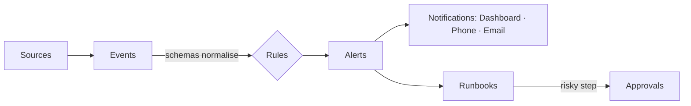

# Alerting service

Gets the right alert to the right people, on the channel they prefer, and helps them fix it with the team's runbooks. Events come in from many sources in any shape; teams decide what matters with rules; people get notified without being flooded.

## Install

You need **Docker** (with Compose), **Node.js 22.6+** and **[just](https://github.com/casey/just)**.

```sh
git clone https://github.com/orowicki/gs-hackathon.git
cd gs-hackathon
just up      # build, start, seed demo data (first build takes 1-2 min)
just demo    # send 60 s of realistic events
```

Open **<http://localhost:3000>** and pick a person (no passwords). Stop with `just down`; wipe all data with `docker compose down -v`.

| Address | What |
| --- | --- |
| <http://localhost:3000> | The app: web UI and API |
| <http://localhost:8080> | ntfy push notifications: subscribe to `alerting-<person>`, e.g. `alerting-anna` |
| <http://localhost:8025> | Mailpit: every email the app sends |
| <http://localhost:4100> | Demo service that runbook actions call |

**Quick tour:** sign in as Anna and watch alerts arrive live in the feed. Open one to see its event, runbook and history, then acknowledge and resolve it. To approve a runbook step, sign in as Julia or Marek (Settlements on-call) and open **Approvals**.

## How it works



A **source** receives events, a **schema** recognises and normalises each kind of event, a **rule** decides who gets alerted and how the alert looks, and **runbooks** tell people (or automation) what to do next.

## Features

### Ingest from many sources
- **Four source types:** HTTP webhook, tailed log file, Redis stream and Kafka. Add one in the UI, in YAML or through the API, with no code.
- **Any schema:** events are stored as they arrive, and schemas map their fields. An event no schema recognises shows up under **Events**, where one click turns it into a new schema.

### Rules teams control
- **Filters on any field** with `=`, `>`, `in`, `contains`, `matches`, AND/OR and parentheses, e.g. `payload.notional > 10000000 AND error.code in [TIMEOUT, REJECTED]`.
- **Per-rule routing and presentation:** each rule picks recipients and channels, plus the alert's title template, fields and colour.
- **Changed at runtime** through the UI, the API, or YAML files in `config/` that reload live. No restart needed.

### Delivery on the preferred channel
- **Channels:** Dashboard (in-app), Phone (ntfy push) and Email (SMTP to Mailpit). Each one is a small plugin, so adding a real SMS or phone provider is one isolated file.
- **Personal preferences:** each person picks channels per severity and sets quiet hours in their own time zone.
- **No lost alerts:** failed deliveries retry with backoff, survive worker crashes, and land in dead letters you can resend from **Channels**.

### Live UI
- **Real-time feed** pushed over server-sent events, with filters, sorting and starring.
- **Acknowledge and resolve** from the alert page; acknowledge (or approve a runbook step) straight from the ntfy notification.
- **Manage** rules, runbooks, sources, schemas, people, groups and your notification preferences.
- **Suggest improvements** to a rule from any alert; suggestions can then be accepted or dismissed.

### No flooding
- **Deduplication:** the same problem repeated becomes one alert with a counter.
- **Grouping and throttling:** rules can bundle alerts by field over a time window, and each person gets at most a few messages per window, with the rest sent as a digest.

### Runbooks that help resolve
- **Any format:** Markdown, links, checklists or free text, filled in with values from the event (workflow ID, service name), in full in the UI and as a link in push and email.
- **Automated steps:** call an HTTP endpoint (retry a workflow, restart a service, open a ticket), escalate to a group, or wait. Steps support conditions (`if`) and retries.
- **Human approval:** risky steps wait for someone in the step's approvers group, who approves from the UI or the ntfy Approve button. The server enforces this.
- **Audit and auto-close:** every action records who did it. An alert closes on its own when the source reports the problem is gone.
- **Self-updating knowledge:** when resolving, a person can save how they fixed it to the rule, so the next person sees it.

### Scalability and performance
- **Horizontal scaling:** the ingest, rule engine and runbook workers share Redis stream consumer groups, so you scale with `WORKERS=N`. Rules, alerts and delivery state live in Postgres and Redis, not in process memory.
- **Measured, not estimated:** `just loadtest` measures throughput and p50/p99 latency. Current results are about 520 events/s with 1 worker and 930 events/s with 2, with no events lost (details in [docs/performance.md](docs/performance.md)).

### Configure with Claude
- The whole service is described by an OpenAPI document at `/api/openapi.json`, and `packages/mcp` is an MCP server, so Claude can add sources, schemas and rules from plain-language requests. See **Connect Claude** in the app.

## What is mocked

- **Sign-in** is a profile picker with no passwords. The API trusts the session cookie or `X-Account` header, so don't expose it to an untrusted network.
- **Phone and SMS** are delivered as ntfy push notifications, and **email** goes to Mailpit, not real inboxes.
- **Upstream systems:** `demo-service` stands in for the APIs that runbooks call, and `just demo` generates the events.

## How we used AI

We built this with Claude Code, using an "autopilot" setup that plans tasks, writes code and tests, and opens draft pull requests (see [docs/autopilot](docs/autopilot)). Guard hooks stop the agent from merging, force-pushing or deleting branches, so a human reviews and merges every change.

## More docs

- [Architecture](docs/architecture.md): processes, streams and storage
- [Config formats](docs/config-formats.md): YAML for sources, schemas, rules, people, runbooks
- [API reference](docs/api.md)
- [Extending](docs/extending.md): new source types, parsers, channels and runbook actions
- [Reference](docs/reference.md): demo options, Kafka, MCP setup, environment variables
- [Performance](docs/performance.md): load-test method and results
