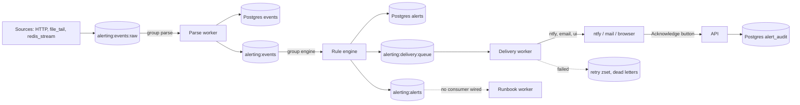

# Architecture

This page describes how the system runs today. Everything here was checked against the code. Where a part is not wired, it says so.

Related docs: [config formats](config-formats.md), [extending the system](extending.md), [Redis names contract](autopilot/interfaces/streams.md).

## Overview

## Processes

The Docker image has one default command: the API (`packages/api/dist/main.js`). `docker-compose.yml` starts these app containers, and `just up` runs `docker compose up -d --build`.

| Process | Container | What it runs |
|---|---|---|
| API | `app` | HTTP server and web UI (port 3000), the delivery worker, the ingest sources runner with the HTTP ingest route, a parse worker, the config store and YAML watcher, the SSE relay, the runbook runner and routes. |
| Ingest worker | `worker` | `packages/ingest/dist/main.js`: a second parse worker. It excludes `http` sources. |
| Engine worker | `worker` | `packages/engine/dist/main.js`: the rule engine, dedup and throttle. |

Details that matter:

- The `worker` container starts the ingest worker and the engine as two Node processes in one shell script. If either exits, the container exits. Scale it with `WORKERS=N` (compose `deploy.replicas`).
- The delivery worker is not a separate process. It runs inside the API (`packages/api/src/main.ts` calls `createDeliveryQueue(...).start()`). There is no standalone delivery entry point. The engine only enqueues; it does not send.
- Ingest sources and the parse worker also run inside the API. The HTTP source needs this, because its route registry lives in the API process. So the API and the `worker` container both read `alerting:events:raw` in group `parse`.
- By default the standalone ingest worker does not run non-HTTP sources (`file_tail`, `redis_stream`). The API runs them. Setting `INGEST_RUN_SOURCES=1` on the worker runs them there too. Do not do both.
- The runbook worker runs in the compose `worker` service as a third process (`packages/api/dist/runbook-worker.js`, source `packages/api/src/runbook-worker.ts`). It calls `startRunbookWorker` from `packages/runbooks/src/worker.ts`, reading `alerting:alerts` in consumer group `runbooks`, so each alert's runbooks start once even with several `WORKERS` replicas. The runner is built by `packages/api/src/runbooks-runtime.ts`, shared with the API, which serves `/api/runbooks` and recovers stale runs on start (the worker does not).
- Postgres, Redis, ntfy, Mailpit and a demo service run as separate containers. `just up` then seeds demo data with `scripts/seed/seed.ts`.

## Redis streams and keys

The source of truth for names is `packages/shared/src/streams.ts`. All names start with `alerting:`. The contract is in [autopilot/interfaces/streams.md](autopilot/interfaces/streams.md). Stream entries have one field, `data`, with a JSON payload.

| Name | Kind | Written by | Read by |
|---|---|---|---|
| `alerting:events:raw` | stream | source plugins (`packages/ingest/src/publisher.ts`) | parse worker, group `parse` |
| `alerting:events` | stream | parse worker | rule engine, group `engine` |
| `alerting:alerts` | stream | rule engine (`AlertEvent` after each match) | read by the runbook worker (group `runbooks`). `GROUP_FANOUT` is defined but unused. |
| `alerting:delivery:queue` | list | rule engine, throttle digests, runbook notifier | delivery worker |
| `alerting:delivery:processing:<workerId>` (plus `...:alive` lease key) | lists | delivery worker, one list per worker, for crash recovery | delivery worker (reaper) |
| `alerting:delivery:retry` | sorted set | delivery worker (retryable failures, score = due time) | delivery worker (moves due items back to the queue) |
| `alerting:delivery:dead` | list | delivery worker (retries exhausted) | API (dead letters page and retry) |
| `alerting:config:changed` | pub/sub | config store | processes that watch config |
| `alerting:ui:push` | pub/sub | engine, delivery, API | API, which relays to browsers over SSE |
| `alerting:dedup:*` | keys | rule engine | rule engine (rule + dedup key to open alert id) |
| `alerting:dedupseen:*`, `alerting:deduplock:*` | keys | rule engine | rule engine (redelivery marker, per-key lock) |
| `alerting:throttle:*`, `alerting:digest:*` | keys | engine throttle | engine throttle |
| `alerting:events:recent` | list | parse worker (capped at 1000) | API, for "test against recent events" |
| `alerting:ingest:failed` | list | parse worker (rows that Postgres rejects, capped at 1000) | nobody reads it in code |

The raw stream (`publisher.ts`) and the events stream (`worker.ts`) are each trimmed with `MAXLEN ~ 1000000` on write. The streams.md contract describes a separate fan-out stage on `alerting:alerts`. The code does not do this. The engine pushes notifications to the delivery queue itself.

## Postgres tables

Migrations run on start. The config migration runs from the API, the ingest worker and the engine. Runbook tables are created by the API.

| Table | Purpose | Owning package |
|---|---|---|
| `sources`, `schemas`, `rules`, `people`, `groups`, `preferences`, `runbooks` | Config entities. Each has `id` and a JSON `data` column. | `packages/config` (`001_init.sql`) |
| `alerts` | One row per alert, with state and the full alert JSON. Written by the engine, changed by ack and resolve. | `packages/config` (`002_alerts.sql`) |
| `alert_audit` | Audit log of alert changes (ack, resolve, suggestions, runbook steps). | `packages/config` (`002_alerts.sql`) |
| `suggestions` | Rule suggestions linked to an alert. | `packages/config` (`002_alerts.sql`) |
| `schema_migrations` | Names of applied migrations. | `packages/config` (`src/migrate.ts`) |
| `events` | Parsed events, with raw text, parsed fields, schema id and common fields. | `packages/ingest` (`ingest_001_events.sql`) |
| `runbook_runs` | State of each runbook run per alert. | `packages/runbooks` |
| `audit_log` | Runbook audit table. The running API does not write it (see below). | `packages/runbooks` |

Notes:

- The `alerts` and `alert_audit` tables are defined in the config package but used by the engine and the API.
- The API wires the runbook runner so that its audit entries go to `alert_audit`, through the alerts audit store. The `audit_log` table is still created, but the runner's audit entries do not go to it in the API.
- The SQL in `packages/runbooks/migrations/runbooks_001.sql` is a reference copy. The executed SQL is inline in `packages/runbooks/src/store-pg.ts`.

## One event, from ingest to ntfy and audit

1. A client sends `POST /ingest/:sourceId` (`packages/api/src/routes/ingest.routes.ts`, `packages/ingest/src/plugins/http.ts`). File and Redis sources feed the same path from `packages/ingest/src/plugins/`.
2. The source emits through `packages/ingest/src/publisher.ts`, which does `XADD alerting:events:raw` with a `RawMessage` (`sourceId`, `receivedAt`, `raw`).
3. A parse worker (`packages/ingest/src/worker.ts`) reads the stream in group `parse`. It parses the text with the source's parser (`packages/ingest/src/parsers/`) and maps it onto a schema (`packages/ingest/src/map-event.ts`, `packages/schemas`). The event id comes from the stream entry id, so redelivery does not make duplicates.
4. In one step the worker inserts into Postgres `events` (`packages/ingest/src/event-store.ts`), then adds the event to `alerting:events` and `alerting:events:recent`, and acks the raw entry.
5. The engine (`packages/engine/src/rules/runner.ts`) reads `alerting:events` in group `engine`. It matches rules (`packages/engine/src/rules/match.ts`, filter language in `packages/filter`).
6. For each match, the dedup hook (`packages/engine/src/dedup/hooks.ts`) takes a Redis lock, then creates or updates the row in `alerts` (`packages/engine/src/dedup/repo.ts`).
7. Routing (`packages/engine/src/routing/route.ts`) picks recipients and channels from people, groups and preferences. The default is the `ui` channel, plus `ntfy` for error and critical alerts when the person has an `ntfyTopic`. Quiet hours and throttling (`packages/engine/src/throttle/index.ts`) can delay or digest it.
8. The engine pushes each notification to `alerting:delivery:queue`, writes an `AlertEvent` to `alerting:alerts`, and publishes on `alerting:ui:push`. It then acks the event.
9. The delivery worker in the API (`packages/delivery/src/queue.ts`) takes the notification into its processing list and sends it through the channel. The ntfy channel (`packages/delivery/src/ntfy.ts`) posts to `NTFY_URL` with an Acknowledge action button that calls `PUBLIC_URL/api/alerts/:id/ack` with an `X-Account` header carrying the recipient's person id, so the acknowledger is recorded.
10. On a retryable failure the notification goes to the retry sorted set with backoff. After max attempts, or a long outage, it goes to the dead letter list.
11. When the user taps Acknowledge, the API (`packages/api/src/routes/alerts/http.ts`) changes the alert state and inserts an `alert_audit` row with `action: "acknowledged"`, in one transaction (`packages/api/src/routes/alerts/store.ts`). Resolve works the same way.

An audit entry is not written when the push is sent. Neither the engine nor the delivery code writes to `alert_audit`. The `created` audit action exists in the type (`packages/shared/src/types/alert.ts`), but no code in the pipeline produces it. The audit entries that exist come from user actions in the API and from runbook runs.

## Scaling

What the code supports:

- Parse workers: yes. They use consumer group `parse`, a unique consumer name per process (host and pid) and `XAUTOCLAIM` for entries stuck in another consumer's pending list. The API's own parse worker is one more consumer.
- Engine: yes. It uses group `engine`, a consumer name with pid and a random suffix, and `XAUTOCLAIM` with a maximum delivery count. Dedup uses a per-key Redis lock, so several engines do not double-create an alert. Delivery is at least once, so a crash can repeat one event.
- Delivery workers: yes in principle. Each worker has its own processing list and an `:alive` lease key (refreshed every 5 s, TTL 15 s). Other workers move the items of a dead worker back to the queue. In the current wiring the only delivery worker is in the API, so it scales only with API replicas. The compose file publishes port 3000 on `app` and sets no replicas for it, so running several API containers needs your own setup.
- Compose scaling: `WORKERS=N` scales the `worker` container (ingest parse worker plus engine).

What does not scale, or is not covered:

- The HTTP ingest route and the in-API sources runner exist in the API process only. Two API replicas would each run all non-HTTP sources and read the same file or stream, so events would be read twice. Use one API instance for sources.
- The runbook worker is not running, so there is nothing to scale.
- Postgres and Redis are single containers in compose.

## Config directory

`config/` holds YAML for `sources`, `schemas`, `rules`, `people`, `groups` and `runbooks` (see `config/README.md`). The API reads it from `CONFIG_DIR` (default `./config`; compose mounts `./config` at `/app/config`). Formats are in [config-formats.md](config-formats.md).

Live reload runs in the API (`packages/api/src/config-watch.ts`, using `packages/config/src/watcher.ts`). On start, a file is loaded only if the entity is not already in Postgres, so edits made through the API survive a restart. After start, file changes are upserted and deleted files delete the entity. Writes publish on `alerting:config:changed`, and the schema registry and runbook registry reload from it. The standalone `worker` processes read config from Postgres. They do not watch the directory.

To add a source type, channel or parser, see [extending.md](extending.md).
